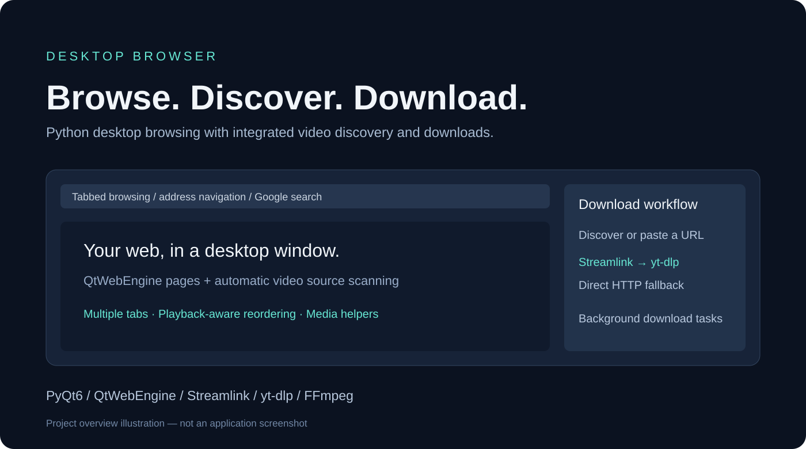

# Desktop Browser

A Windows-oriented desktop web browser built with Python, PyQt6 and QtWebEngine, with tabbed browsing, automatic video discovery and integrated media downloads.



*Project overview illustration, not an application screenshot. The current window title and packaged executable retain the original “Private Browser” name.*

## Features

- Browse in multiple tabs with back, forward, reload and address-bar navigation.
- Enter a URL or search Google from the address bar.
- Discover video sources from page elements every three seconds, with a list of detected media.
- Download a selected video or paste a media/page URL into the download panel.
- Run downloads in background Qt threads and show progress and completion status.
- Try Streamlink first, then yt-dlp, then a direct HTTP download fallback.
- Optionally auto-download detected videos and move playing-video tabs toward the front (checked every five seconds).
- Clear detected videos and completed download entries.
- Access FFmpeg conversion, audio extraction and metadata helper methods in the source.

Support for an individual website, codec or stream depends on the installed dependencies and the site's behavior. DRM-protected media and blob URLs are not supported by the page scanner. FFmpeg helpers are source-level utilities, not a complete editing interface or an automatic conversion guarantee for every download.

## Requirements

- Windows is the intended packaging and installation target. Other operating systems have not been validated for this repository.
- Python 3.10 or newer is required by the source's type-annotation syntax; use a version supported by the current PyQt6 wheels.
- Dependencies listed in `requirements.txt`: PyQt6, PyQt6-WebEngine, requests, yt-dlp, streamlink and ffmpeg-python.
- FFmpeg and FFprobe executables on `PATH` for media-processing helpers. The `ffmpeg-python` package alone does not install these executables.
- An internet connection for remote browsing and downloads.

## Run from source

```powershell
git clone https://github.com/vams2krish/Desktop-Browser.git
cd Desktop-Browser
py -m venv .venv
.\.venv\Scripts\python.exe -m pip install --upgrade pip
.\.venv\Scripts\python.exe -m pip install -r requirements.txt
.\.venv\Scripts\python.exe main.py
```

The app starts on Google. No administrator permissions are required for running the source application.

## Usage

1. Enter a website address or search phrase and press Enter or click **Go**.
2. Use **+** to open another tab and the tab close control to close one.
3. Wait for the **Detected Videos** list to populate on a page containing supported video sources.
4. Select an entry and click **Download Selected Video**, or paste a URL into the right-hand input and click **Download**.
5. Monitor **Active Downloads**. Files are written to `%USERPROFILE%\Downloads\BrowserDownloads`.
6. Enable **Auto-download detected videos** only when you want detected media to download automatically.

For streams whose total size is unknown, progress may be approximate. A download can fail even when a media URL is detected, particularly when authentication, expiring URLs or site-specific playback logic is involved. Download only media you have permission to save.

## Architecture

| File | Responsibility |
| --- | --- |
| `main.py` | Main window, navigation, tabs, download panel, background download workers and tab reordering |
| `browser_tab.py` | QtWebEngine view, JavaScript video discovery and media-processing helpers |
| `utils.py` | Logging, filename cleanup and opening folders |
| `requirements.txt` | Python runtime dependencies |
| `simple-browser.spec` | Existing PyInstaller packaging recipe |
| `version_info.txt` | Windows executable version metadata |
| `install.bat` | Installs an already-built executable and creates shortcuts |
| `docs/images/desktop-browser.svg` | Illustrated project overview |

The main download worker attempts Streamlink, then yt-dlp, and finally a streamed requests download. Browser discovery and download extraction are separate steps; the downloader does not automatically receive the browser's authenticated session.

## Windows packaging

Install PyInstaller separately:

```powershell
.\.venv\Scripts\python.exe -m pip install pyinstaller
```

The existing spec expects these externally supplied binaries:

```text
ffmpeg-master-latest-win64-gpl/bin/ffmpeg.exe
ffmpeg-master-latest-win64-gpl/bin/ffplay.exe
ffmpeg-master-latest-win64-gpl/bin/ffprobe.exe
```

After supplying them, the intended build command is:

```powershell
.\.venv\Scripts\python.exe -m PyInstaller simple-browser.spec
```

The spec also references `os.path.exists` without explicitly importing `os`; review that import when preparing a build. The recipe targets `dist/PrivateBrowser.exe`. It is retained from the original project and may require adjustments for the installed PyInstaller version; a fresh executable build has not been verified for this publication. `install.bat` copies that executable into Program Files and creates desktop and Start Menu shortcuts, so that installation step needs administrator privileges. It does not install Python dependencies or build the app.

No prebuilt executable, FFmpeg distribution or release download is included in this initial repository.

## Local data and privacy

- Downloads are saved in the user's Downloads folder.
- `utils.py` writes diagnostics to `browser.log` in the working directory.
- QtWebEngine enables JavaScript and local storage and uses a browser profile. The project does not explicitly enforce an off-the-record profile or guarantee that history and cookies are erased.
- The source enables autoplay and mixed content and changes the user-agent string. The current “Private Browser” window title should not be interpreted as a verified privacy or security guarantee.
- There is no documented settings-file interface; configure behavior through the existing UI or source.

## Troubleshooting

| Problem | Check |
| --- | --- |
| Missing PyQt6 or WebEngine imports | Install requirements with the same virtual-environment Python used to launch the app |
| FFmpeg/FFprobe not found | Install the executables and confirm `ffmpeg -version` and `ffprobe -version` work |
| Videos are not detected | Allow a few seconds after playback starts; some pages expose only blob URLs or protected players |
| Site downloads fail | Update yt-dlp and Streamlink in the virtual environment and retry with the original page URL |
| Packaging fails | Verify the FFmpeg paths in the spec and its compatibility with your PyInstaller version |
| Unexpected behavior | Review the local `browser.log`; remove personal URLs before sharing diagnostics |

## Development and verification

```powershell
.\.venv\Scripts\python.exe -m compileall main.py browser_tab.py utils.py
```

For manual checks, launch the app, navigate to a page, open and close tabs, test discovery with media you control, and verify a small permitted download reaches the output directory. Python compilation passed for this publication. Application launch attempts exited before a screenshot could be captured in the publishing environment, including Python 3.11 and 3.14 attempts. Runtime behavior, external website downloads and the installer remain unverified. The image above is an overview illustration.

Report reproducible bugs and feature requests in [GitHub Issues](https://github.com/vams2krish/Desktop-Browser/issues). Include the Python/Windows versions, dependency versions, reproduction steps and a sanitized error message.

## Project status and licensing

This repository publishes a clean source snapshot of the existing Simple-Browser project under the Desktop-Browser repository name. Generated binaries, build output, logs, bytecode and downloaded third-party archives are excluded.

No project license file has been supplied. Do not assume an MIT or other open-source license from this repository's public visibility. Dependencies and any separately acquired FFmpeg binaries retain their respective licenses.

